# System Architecture — Project 7 Digital Communication System

## 1. Architectural Overview

Project 7 implements a complete, end-to-end, baseband digital communication system that transmits speech audio over a noisy complex Additive White Gaussian Noise (AWGN) channel. The system integrates source coding, channel coding, digital modulation, coherent demodulation, syndrome error correction, and audio reconstruction.

```mermaid
flowchart LR
    A["Audio Source\n(8 kHz, 10s mono)"] --> B["mu-law PCM Encoder\n(mu=255, 3/4/8-bit)"]
    B --> C["SECDED Channel Encoder\n((8,4) Systematic Block Code)"]
    C --> D["QPSK Modulator\n(Gray Mapping, Es=1.0)"]
    D --> E["Complex AWGN Channel\n(snrDB: 0 to 10 dB)"]
    E --> F["QPSK ML Demodulator\n(Nearest-Neighbor Decision)"]
    F --> G["SECDED Syndrome Decoder\n(1-bit Correct, 2-bit Detect)"]
    G --> H["mu-law PCM Decoder\n(Reconstruction + Scaling)"]
    H --> I["Audio Sink / Output\n(Playback & WAV Export)"]
```

---

## 2. Pipeline Subsystems and Interfaces

### 2.1 Audio Input Subsystem (`src/person1_audio/audio_input.m`)
- **Input Source:** Course-provided WAV file, synthetic multitone speech signal, or live microphone capture.
- **Sampling Frequency:** Target $F_s = 8000\text{ Hz}$ (standard ITU-T G.711 telephony rate).
- **Duration Policy:** Standardized to 10.0 seconds ($80,000$ samples). Inputs longer than 10 s are truncated; inputs shorter are zero-padded.
- **Channel Format:** Multichannel signals are averaged to mono: $x[n] = \frac{1}{M}\sum_{m=1}^M x_m[n]$.
- **Normalization:** Signals are normalized to dynamic range $[-1.0, +1.0]$ with the original peak factor recorded in `metadata.peakScale`.
- **Resampling:** When the input sampling rate differs from $8000\text{ Hz}$, bandlimited piecewise cubic polynomial interpolation (`interp1` with `pchip`) is performed without requiring external toolboxes.

### 2.2 Source Coding: $\mu$-law PCM (`src/person1_audio/pcm_encoder.m`, `pcm_decoder.m`)
- **Companding:** $\mu$-law non-linear compression with parameter $\mu = 255$:
  $$y = \text{sgn}(x) \frac{\ln(1 + \mu |x|)}{\ln(1 + \mu)}, \quad y \in [-1, 1]$$
- **Quantization:** Uniform mid-rise quantizer with $L = 2^{n_{\text{bits}}}$ bins where $n_{\text{bits}} \in \{3, 4, 8\}$.
  - Step size: $\Delta = \frac{2}{L}$
  - Quantizer index: $q = \text{clamp}\left(\left\lfloor \frac{y + 1}{\Delta} \right\rfloor, 0, L-1\right)$
  - Reconstructed compressed value: $\hat{y} = -1 + (q + 0.5)\Delta$
- **Bit Packing:** Indices $q \in [0, L-1]$ are serialized into $n_{\text{bits}}$ binary bits (MSB first) using bitwise masking (`bitshift` and `bitand`).
- **Inverse Expansion:**
  $$\hat{x} = \text{sgn}(\hat{y}) \frac{(1 + \mu)^{|\hat{y}|} - 1}{\mu}$$

### 2.3 Channel Coding: $(8,4)$ SECDED (`src/person2_channel_coding/`)
- **Code Type:** Systematic linear block code $(n=8, k=4)$, code rate $R_c = 4/8 = 1/2$.
- **Generator and Parity-Check Matrices:**
  $$H = \begin{bmatrix}
  1 & 0 & 1 & 1 & 1 & 0 & 0 & 0 \\
  1 & 1 & 1 & 0 & 0 & 1 & 0 & 0 \\
  0 & 1 & 1 & 1 & 0 & 0 & 1 & 0 \\
  1 & 1 & 0 & 1 & 0 & 0 & 0 & 1
  \end{bmatrix}, \quad
  G = \begin{bmatrix}
  1 & 0 & 0 & 0 & 1 & 1 & 0 & 1 \\
  0 & 1 & 0 & 0 & 0 & 1 & 1 & 1 \\
  0 & 0 & 1 & 0 & 1 & 1 & 1 & 0 \\
  0 & 0 & 0 & 1 & 1 & 0 & 1 & 1
  \end{bmatrix}$$
- **Orthogonality:** $G \cdot H^T \equiv 0 \pmod 2$.
- **Error Correction Capability:**
  - Minimum Hamming distance $d_{\min} = 4$.
  - Single Error Correction, Double Error Detection (SECDED).
  - All 8 columns of $H$ are unique and have odd Hamming weight (weights 1 and 3).
  - Odd syndrome $\implies$ single-bit error corrected.
  - Even non-zero syndrome $\implies$ double-bit error detected as uncorrectable (no false correction).

### 2.4 Digital Modulation: Gray QPSK (`src/person3_modulation/qpsk_mod.m`, `qpsk_demod.m`)
- **Modulation Scheme:** Quadrature Phase Shift Keying (QPSK) with 2 coded bits per complex symbol ($k_{\text{mod}} = 2$).
- **Constellation Mapping (Gray Coded):**
  - `00` $\rightarrow (+1 + j)/\sqrt{2}$ (Quadrant 1)
  - `01` $\rightarrow (-1 + j)/\sqrt{2}$ (Quadrant 2)
  - `11` $\rightarrow (-1 - j)/\sqrt{2}$ (Quadrant 3)
  - `10` $\rightarrow (+1 - j)/\sqrt{2}$ (Quadrant 4)
- **Average Symbol Energy:** $E_s = \frac{1}{4}\left(\left|\frac{1+j}{\sqrt{2}}\right|^2 + \left|\frac{-1+j}{\sqrt{2}}\right|^2 + \left|\frac{-1-j}{\sqrt{2}}\right|^2 + \left|\frac{1-j}{\sqrt{2}}\right|^2\right) = 1.0$.
- **ML Demodulation:** Exact minimum-distance Euclidean decision equivalent to separable sign thresholding:
  $$b_1 = \begin{cases} 0, & \text{Im}(r) \ge 0 \\ 1, & \text{Im}(r) < 0 \end{cases}, \quad
    b_2 = \begin{cases} 0, & \text{Re}(r) \ge 0 \\ 1, & \text{Re}(r) < 0 \end{cases}$$

### 2.5 Channel Model: Complex Baseband AWGN (`src/person3_modulation/add_awgn.m`)
- Complex noise vector $w = w_I + j w_Q$ added to transmitted symbols:
  $$r = s + w$$
- Noise distribution: $w_I \sim \mathcal{N}(0, N_0/2)$, $w_Q \sim \mathcal{N}(0, N_0/2)$, giving total noise power $\mathbb{E}[|w|^2] = N_0$.
- **Energy Bookkeeping and SNR Definitions:**
  - **$E_s/N_0$:** Symbol SNR in dB: $N_0 = \frac{E_s}{10^{\text{SNR}_{\text{dB}}/10}}$.
  - **$E_b/N_0$:** Information bit SNR. Since each symbol carries $k_{\text{mod}} = 2$ coded bits and the code rate is $R_c = 1/2$, the number of information bits per symbol is $k_{\text{info}} = k_{\text{mod}} \cdot R_c = 2 \cdot (1/2) = 1$. Therefore, for the coded system:
    $$E_s = E_{b,\text{info}} \implies (E_s/N_0)_{\text{dB}} = (E_{b,\text{info}}/N_0)_{\text{dB}}$$
  - For uncoded QPSK baseline ($R_c = 1$): each symbol carries 2 information bits, so $E_s = 2 E_{b,\text{info}}$, meaning $(E_s/N_0)_{\text{dB}} = (E_{b,\text{info}}/N_0)_{\text{dB}} + 3.01\text{ dB}$.

---

## 3. Data Representation and Types

| Variable | Physical Meaning | MATLAB Data Type | Dimensions | Valid Range |
|---|---|---|---|---|
| `audioIn` | Normalized source audio | `double` | $N_{\text{samp}} \times 1$ | $[-1.0, +1.0]$ |
| `pcmBits` | Information bitstream | `double` | $(N_{\text{samp}} \cdot n_{\text{bits}}) \times 1$ | $\{0, 1\}$ |
| `codedBits` | (8,4) Encoded bitstream | `double` | $(2 \cdot N_{\text{info}}) \times 1$ | $\{0, 1\}$ |
| `txSymbols` | Baseband QPSK symbols | `complex double` | $(N_{\text{coded}}/2) \times 1$ | Unit circle ($E_s=1$) |
| `rxSymbols` | Noisy received symbols | `complex double` | $(N_{\text{coded}}/2) \times 1$ | Complex plane $\mathbb{C}$ |
| `demodBits` | Demodulated coded bits | `double` | $N_{\text{coded}} \times 1$ | $\{0, 1\}$ |
| `decodedBits`| Decoded information bits | `double` | $N_{\text{info}} \times 1$ | $\{0, 1\}$ |
| `reconstructed`| Reconstructed audio | `double` | $N_{\text{samp}} \times 1$ | Dynamic range of source |
